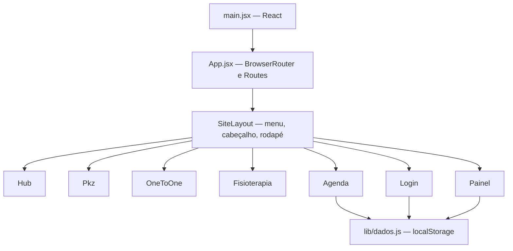

# Arquitetura técnica — Migração para React e Vercel

> 09/11/2026 · Entrega acadêmica Grupo 3 — Projeto Front-End IBMEC.

## 1. Decisão de tecnologia

A versão anterior era um conjunto de páginas HTML, estilos CSS e JavaScript imperativo. A atualização é uma **SPA React** compilada pelo **Vite**. O arquivo `index.html` contém somente metadados e `#root`; cada página é um componente `.jsx`. Não são carregados `comum.js`, `agendamento.js`, `conta.js` ou `painel.js` antigos como scripts DOM.

### Árvore de componentes

A `SiteLayout` aplica a classe CSS correta ao `body`, atualiza o título do navegador e faz a rolagem para âncoras de seção. O menu responsivo usa `useState` para abrir e fechar; teclado Escape, clique fora e redimensionamento o encerram.

## 2. Rotas e redirecionamento

| Caminho | Componente | Exemplo de acesso |
|---|---|---|
| `/` | Hub | Página inicial |
| `/pkz` | Pkz | PKZ |
| `/one-to-one` | OneToOne | One to One |
| `/fisioterapia` | Fisioterapia | Nova área |
| `/agendamento?marca=pkz`/`oto` | Agenda | Grade por marca |
| `/login?marca=pkz`/`oto` | Login | Demonstração |
| `/area-do-atleta` | Painel | Área demonstrativa |

Para manter links de projetos anteriores utilizam-se `Navigate` e rotas de compatibilidade para `index.html`, `pkz.html`, `one-to-one.html`, `fisioterapia.html`, `agendamento.html`, `login.html` e `area-aluno.html`. A Vercel usa o fallback descrito em `vercel.json` para responder a URLs de SPA recarregadas diretamente.

## 3. Conservação visual

As seções de conteúdo HTML de 06/11 foram convertidas para JSX real, com `className`, `htmlFor`, links internos do React Router e imagens em `/assets/`. Os arquivos CSS por marca permanecem, acrescidos de `react-ajustes.css` para lidar com o novo wrapper `#root` e a melhoria do contraste no menu. A responsividade original segue a abordagem mobile first com breakpoints em 480, 640, 900 e 1200 px. As imagens da nova página são genéricas e identificadas como ilustrativas; não há qualquer alegação de profissionais reais retratados.

## 4. Estado e dados

- **Agenda:** `useState` controla semana 0–3, dia visível, seleção de horário, formulários, confirmações e mensagens. `useMemo` constrói listagens a partir de `lerReservas`. `useEffect` reage a eventos `storage` e `focus` para atualizar a visualização.
- **Validação:** a reserva exige data futura, slot sem conflito, nome com 2+ caracteres, telefone com 10–13 dígitos e e-mail validado pelo formulário. Os registros continuam com o prefixo `grupo-pkz-oto-v1-`, preservando dados de demonstração de versões anteriores do mesmo domínio.
- **Acesso:** `sessionStorage` mantém somente a sessão demonstrativa. `Login.jsx` aceita o login fixo de apresentação e, por compatibilidade, contas *legadas de teste* já salvas localmente em versões antigas. Não há criação pública de conta.
- **Painel:** identifica a sessão local e exibe reservas futuras do e-mail + marca. Os gráficos, relatórios e indicadores são fictícios. A fisioterapia não compartilha a agenda dessas marcas nem cria dados próprios.

**Privacidade:** uma agenda em `localStorage` não constitui autenticação ou isolamento de dados. O produto não deve receber dados pessoais de clientes reais; para comercializar seria necessário backend, política de tratamento, controles de acesso e revisão de LGPD.

## 5. Correspondência do legado

| Legado HTML/JS | React |
|---|---|
| `index.html` (conteúdo) | `src/pages/Hub.jsx` |
| `pkz.html` | `src/pages/Pkz.jsx` |
| `one-to-one.html` | `src/pages/OneToOne.jsx` |
| `fisioterapia.html` | `src/pages/Fisioterapia.jsx` |
| `agendamento.html`, `agendamento.js` | `src/pages/Agenda.jsx` |
| `login.html`, `conta.js` (versão anterior recuperada) | `src/pages/Login.jsx` |
| `area-aluno.html`, `painel.js` (versão anterior recuperada) | `src/pages/Painel.jsx` |
| `dados.js` | `src/lib/dados.js` |
| `comum.js` | `src/components/SiteLayout.jsx` |
| `*.css` | `src/styles/*.css` |
| `assets/*` | `public/assets/*` |

**Observação sobre a origem:** o repositório vanilla consultado em 09/11 não continha `login.html` e `area-aluno.html`, embora a documentação os citasse. As telas e seus comportamentos foram recuperados do pacote acadêmico anterior `pkzfinal4-corrigido.zip` para não entregar links quebrados. A Fisioterapia e o novo layout do hub vieram de `PKZ_OneToOne_Fisioterapia_Atualizado.zip` gerado em 06/11, uma versão mais recente do conteúdo institucional do mesmo projeto.

## 6. Verificação e limitações

A geração de arquivos e a análise de sintaxe JSX foram realizadas; os módulos de regras de armazenamento e datas são testáveis via `node --test`. A instalação npm e o build completo do Vite **dependem de acesso à rede não disponível no ambiente de montagem**. A instalação, o teste do build e a conferência visual no navegador após a publicação continuam obrigatórios; não se declaram resultados de WAVE, Lighthouse ou testes reais com usuários sem evidência.
