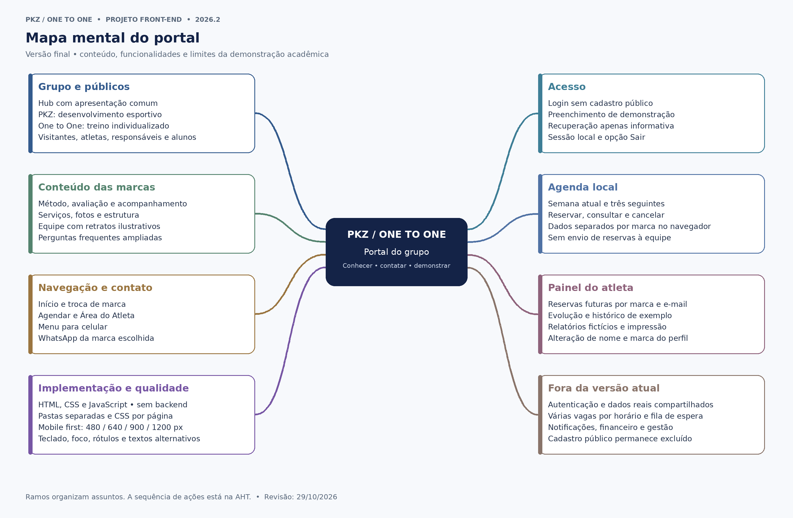

# Mapa mental — Portal PKZ / One to One

> Projeto Front-End · IBMEC · 2026.2 · Grupo 3 — sexta-feira
> Histórico: revisão de 29/10/2026 (duas marcas). **Adendo da terceira área em 09/11/2026**.

## 1. Ideia central

**Portal PKZ / One to One:** apresentar duas marcas do mesmo grupo, facilitar o contato e demonstrar a experiência do atleta em um front-end responsivo.

O mapa organiza os conceitos e funcionalidades por assunto. Diferentemente da AHT, não define uma ordem de execução. Esta versão reflete o que está presente no trabalho final e separa as evoluções que ainda não foram implementadas.

## 2. Mapa visual — escopo histórico de duas marcas

## 3. Ramificações

### Grupo e públicos

- Hub com apresentação comum.
- PKZ: desenvolvimento esportivo, principalmente infantojuvenil.
- One to One: treinamento individualizado, principalmente para adultos.
- Visitantes, atletas, responsáveis e alunos.

### Conteúdo das marcas

- Apresentação e método de trabalho.
- Avaliação, planejamento e acompanhamento.
- Serviços, galeria e estrutura.
- Equipe com retratos ilustrativos.
- Perguntas frequentes ampliadas.

### Navegação e contato

- Voltar ao início e alternar entre as marcas.
- Botões Agendar e Área do Atleta.
- Menu adaptado ao celular.
- WhatsApp específico de cada marca.
- Formatos e valores tratados com a equipe.

### Acesso

- Login compartilhado pelas duas marcas.
- Sem cadastro público.
- Preenchimento da conta de demonstração.
- Orientação de recuperação sem envio de e-mail.
- Sessão local e opção Sair.

### Agenda local

- Semana atual e três seguintes.
- Horários livres, reservados e encerrados.
- Reserva com nome, e-mail e telefone.
- Consulta, cancelamento e limpeza de testes.
- Dados separados por marca, salvos no navegador.
- Sem confirmação enviada à empresa.

### Painel do atleta

- Próximos agendamentos por marca e e-mail.
- Indicadores e frequência semanal de exemplo.
- Observações, histórico e relatórios fictícios.
- Impressão pelo navegador.
- Alteração de nome e marca no perfil.

### Implementação e qualidade

- HTML, CSS e JavaScript.
- Pastas `html/`, `css/`, `js/` e `assets/`.
- CSS comum e CSS por página.
- Mobile first; 480, 640, 900 e 1200 px.
- Teclado, rótulos, foco e textos alternativos.
- Sem backend nem banco de dados.

### Fora da versão atual

- Autenticação e dados reais compartilhados.
- Capacidade de vários atletas por horário.
- Fila de espera e notificações.
- Gestão de professores, pagamentos e integração com o aplicativo.
- Cadastro público permanece excluído por decisão do cliente.

## 4. Relação com a documentação

O [Brainstorm](../Brainstorm.md) registra ideias e decisões. Este mapa reúne os temas. O [5W2H](../5W2H.md) apresenta o planejamento; o [Documento de Visão](<../Doc visão.md>) delimita o produto; os [requisitos](../Requisitos.md) descrevem seu comportamento; a [AHT](../AHT/AHT.md) detalha as tarefas do usuário; o [Scrum](../scrum.md) organiza o trabalho e as entregas.

## Adendo — Terceira área e stack React (09/11/2026)

O mapa mental histórico foi feito quando existiam duas marcas. A ramificação de **grupo e públicos** passa a incluir **Fisioterapia**; **navegação** inclui `/fisioterapia` e retorno ao hub; **implementação e qualidade** passam a citar React JSX, React Router, Vite, Vercel e testes de estado. A fisioterapia ainda depende de conteúdo específico aprovado pelo cliente e não oferece agenda própria. Ver o novo mapa em formato Mermaid no arquivo [mindmap-react.mmd](mindmap-react.mmd) (a imagem PNG histórica foi mantida como registro da etapa anterior).
